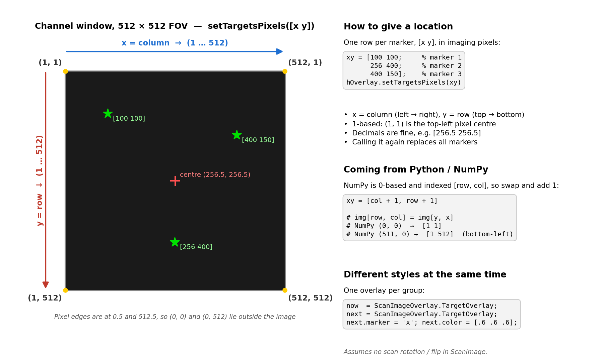

# si_overlay

Draws target markers (`*`, `x`, `+` or `o`) on top of the ScanImage channel windows and the merge window.
No ScanImage files are changed. It attaches to the running `hSI` from the base workspace.

Supports one FOV and one plane for now.

## Setup

Add `ScanImageTools/code` (the folder containing `+sitools`) to the MATLAB path.

## Usage

```matlab
hOverlay = sitools.si_overlay.TargetOverlay;      % create once (ScanImage must be running)

hOverlay.setTargetsPixels([100 100; 256 256])   % targets in imaging pixels (1-based)
hOverlay.setTargets(xyRef)                      % or in ScanImage reference space
hOverlay.clear                                  % remove the points, keep the overlay

hOverlay.marker = 'x';                          % '*', 'x', '+' or 'o'
hOverlay.color = [1 0 0];
hOverlay.markerSize = 15;
hOverlay.hide; hOverlay.show;

delete(hOverlay)                                % remove markers and listener
```

## Demo

```matlab
hOverlay = sitools.si_overlay.demo        % real ScanImage if running, otherwise dummy mode
hOverlay = sitools.si_overlay.demo(true)  % always dummy mode
```

With real ScanImage, start it and Focus once first.

Dummy mode needs no rig. It opens a blank 512×512 "channel window" (`sitools.si_overlay.dummy.SI`) and puts it in the base
workspace as `hSI`, so the overlay is used exactly as on the rig. Hover over the window to see the pixel under the
mouse in the title bar. Close the window to end dummy mode.

```matlab
hOverlay.setTargetsPixels([1 1; 512 512])  % should land on the top-left and bottom-right corners
hOverlay.marker = 'x'; hOverlay.color = [1 0 0];
hSI.focus                                  % dummy only: rebuilds the window like Focus does; markers come back
delete(hOverlay)
```

The dummy copies only the parts of ScanImage the overlay uses (`hDisplay.hAxes`, `RoiDisplay.hOnTopGroup` and the
scanfield's `pixelToRefTransform`), using the same formulas, so code that works on the dummy should work on the rig.

## Giving locations



Pass an N×2 matrix, one row per marker, as `[x y]`:

- `x` = column (left → right), `y` = row (top → bottom), as seen in the channel window.
- Pixels are 1-based: `(1, 1)` is the top-left pixel, `(512, 512)` the bottom-right on a 512×512 FOV.
  The image spans 0.5 to 512.5, so `(0, 0)` or `(0, 512)` are just outside it. Decimals are fine.
- Calling `setTargetsPixels` / `setTargets` again replaces all markers. To add one, append a row to your list and
  pass the whole list again.

From Python / NumPy (0-based, indexed `[row, col]`), swap and add 1:

```python
xy = np.column_stack([cols + 1, rows + 1])   # NumPy (0, 0) -> [1 1], (511, 0) -> [1 512]
```

To show groups in different styles at the same time (e.g. current vs. next hologram), create one overlay per group.
Each one owns its own markers:

```matlab
now  = sitools.si_overlay.TargetOverlay;
next = sitools.si_overlay.TargetOverlay;
next.marker = 'x'; next.color = [.6 .6 .6];
now.setTargetsPixels(xyNow);
next.setTargetsPixels(xyNext);
```

This assumes no scan rotation or flip is set in ScanImage. Otherwise the image is rotated in the window and so are the
markers (they still land on the same pixels).

## Notes

- Markers are drawn in ScanImage reference space, so they follow pan and zoom.
- When ScanImage rebuilds its windows (Focus/Grab, channel changes), it deletes the markers. The overlay listens to
  `hSI.hDisplay.hAxes` and draws them again automatically.
- `pixelToRef` / `refToPixel` convert between imaging pixels and reference space using the current FOV.
- Uses hidden ScanImage properties (`RoiDisplay.hOnTopGroup`, `Display.hAxes`). Written against ScanImage 2024.
